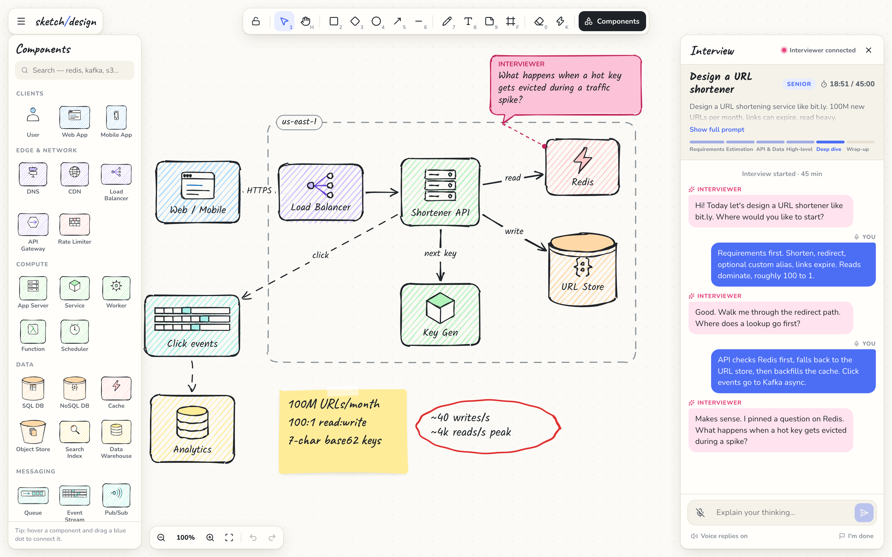

# sketch/design — the system design interview board

A hand-drawn whiteboard for system design mock interviews, plus an MCP server that turns **Claude or ChatGPT into your interviewer**. It sees your board, listens to you, talks back, pins questions on your components, and ends with scored feedback.



- **Pencil-style canvas**: a paper or chalkboard theme, with shapes that look drawn by hand (rough.js + perfect-freehand)
- **27 system design components**: load balancer, API gateway, CDN, cache, SQL and NoSQL databases, object store, queue, Kafka-style stream, pub/sub, workers, serverless functions, auth, monitoring, ML and more
- **Arrows that stay attached** to components, with labels, curved or elbow routes, and dashed lines for async flows. Hover a component and drag its blue dot to connect it.
- **Interview panel**: the problem, a timer, a phase tracker, chat, **voice in** (speech-to-text) and **voice out** (the interviewer's replies are read aloud)
- **The interviewer can** read your diagram as structured data, look at a picture of it, pin comments on components, highlight things, sketch reference designs, and grade you at the end
- **Runs entirely on your machine.** The AI runs in your own Claude or ChatGPT app, on your existing subscription, with no API keys.

## Install

Requires **Node.js 18+**.

| Your AI app | How to connect | Billed to |
| --- | --- | --- |
| **Claude Desktop** | Double-click `sysdesign-board-x.y.z.mcpb` from [Releases](../../releases), or run `npx -y sysdesign-board install` | Claude Pro / Max |
| **Claude Code** | `claude mcp add sysdesign-board -- npx -y sysdesign-board` | Claude Pro / Max |
| **Codex CLI** | Add it to `~/.codex/config.toml` ([below](#codex-cli)) | ChatGPT Plus / Pro |
| **ChatGPT** (desktop / web) | Developer Mode connector through a tunnel ([below](#chatgpt-app)) | ChatGPT Plus / Pro |
| **Cursor, Windsurf, VS Code, others** | The standard MCP JSON ([below](#any-other-mcp-client)) | Your plan there |

The `.mcpb` one-click file is Claude Desktop only. Every other app runs the same npm package.

### Claude Desktop

**Option A: one-click.** Download the `.mcpb` file from Releases and double-click it. Claude Desktop shows an install dialog.

**Option B: command line.** First **quit Claude Desktop completely** (macOS: ⌘Q; Windows: tray icon → Quit). Claude rewrites its config file from memory when it quits, which would drop the new entry. Then run:

```bash
npx -y sysdesign-board install
```

Reopen Claude Desktop.

**Option C: edit the config yourself** (again, with Claude Desktop quit). The file is at:

- macOS: `~/Library/Application Support/Claude/claude_desktop_config.json`
- Windows: `%APPDATA%\Claude\claude_desktop_config.json`
- Linux (unofficial builds): `~/.config/Claude/claude_desktop_config.json`

```json
{
  "mcpServers": {
    "sysdesign-board": { "command": "npx", "args": ["-y", "sysdesign-board"] }
  }
}
```

On Windows, use `"command": "cmd", "args": ["/c", "npx", "-y", "sysdesign-board"]`. If Claude can't find `npx` (common with nvm, Volta or asdf), use the absolute path from `which npx` (macOS/Linux) or `where npx` (Windows).

### Claude Code

Either add the server directly:

```bash
claude mcp add sysdesign-board -- npx -y sysdesign-board
```

Or install the plugin, which also adds an interview skill, from this repo's marketplace. Run these inside Claude Code:

```
/plugin marketplace add tGhattas/sysdesign-board
/plugin install sysdesign-board@sysdesign-board
```

### Codex CLI

Add this to `~/.codex/config.toml` (Windows: `%USERPROFILE%\.codex\config.toml`):

```toml
[mcp_servers.sysdesign-board]
command = "npx"
args = ["-y", "sysdesign-board"]
tool_timeout_sec = 120
```

### ChatGPT app

ChatGPT connects to MCP servers over public HTTPS, so you run the board locally and expose **only** its `/mcp` endpoint through a tunnel. The board itself, its API and its WebSocket refuse any request that doesn't come from `localhost`.

1. Start the board, and keep this running:
   ```bash
   npx -y sysdesign-board serve
   ```
2. In another terminal, open a tunnel (here with [cloudflared](https://developers.cloudflare.com/cloudflare-one/connections/connect-networks/downloads/)):
   ```bash
   cloudflared tunnel --url http://localhost:4321
   ```
3. Get your private connector token:
   ```bash
   npx -y sysdesign-board token
   ```
4. In ChatGPT, go to Settings → Apps & Connectors → Advanced, enable **Developer Mode**, then **Create** a connector with the URL `https://<your-tunnel>.trycloudflare.com/mcp?token=<token>` and no authentication.

Treat that URL like a password. To change the token, delete `~/.sysdesign-board/token`, or set `SYSDESIGN_TOKEN` yourself.

### Any other MCP client

```json
{ "command": "npx", "args": ["-y", "sysdesign-board"] }
```

## Use it

Start a new chat and say:

> Start a system design interview with me on my sketch board.

Or use the **interview** prompt from your app's prompt or slash menu. The board opens at **http://localhost:4321**.

- Draw your design. Talk with the 🎤 **mic** (your message is sent when you pause) or type in the panel.
- The interviewer keeps listening between replies. It is woken by what you say, and when you stop drawing for a few seconds.
- Click **I'm done** when you're finished to get a feedback card with scores.

The board also works without any AI: run `npx -y sysdesign-board serve` and open http://localhost:4321.

### Tools the interviewer gets

| Tool | What it does |
| --- | --- |
| `start_interview` | Sets the problem, level and duration, opens the board, and speaks the opening line |
| `wait_for_candidate` | Waits for your speech or messages, or for board changes once you stop drawing |
| `say` | Sends a chat message, read aloud |
| `get_board` | Structured diagram: components, connections (with labels; dashed means async), zones, notes, and what changed |
| `get_board_image` | A PNG of the whole board (for handwriting and sketches) |
| `annotate` / `clear_annotations` | Pin or remove "INTERVIEWER" comment bubbles on components |
| `highlight` | Makes components glow, optionally zooming to them |
| `draw_on_board` | Adds components, connections, notes and zones in the same sketchy style |
| `set_phase` | Requirements → Estimation → API & Data → High-level → Deep dive → Wrap-up |
| `end_interview` | Feedback card with 1–5 scores, strengths and improvements |
| `get_transcript`, `open_board` | Housekeeping |

## Voice

- **Speech-to-text** uses the browser's Web Speech API. Use **Chrome, Edge or Safari**; Firefox doesn't support it.
- **Text-to-speech** uses your system voices. Toggle it with "Voice replies" in the panel. The mic pauses while the interviewer speaks, so it doesn't transcribe itself.
- The native voice modes inside the ChatGPT and Claude apps can't be piped into another page. Those voice models are only available through paid APIs.

## Keyboard

`V` select · `H` hand / hold `Space` · `R` rect · `D` diamond · `O` ellipse · `A` arrow · `L` line · `P` pen · `T` text · `N` sticky note · `F` zone · `E` eraser · `K` laser · `C` components · `I` interview panel · `Q` tool lock · `G` grid snap · `⌘/Ctrl Z` undo · `⌘/Ctrl D` duplicate · `⇧1` fit · `?` all shortcuts

## Privacy Policy

The full policy is in [PRIVACY.md](PRIVACY.md). In short:

- **What it handles:** your board, the interview chat and voice transcripts, your settings, and a local access token.
- **Where it's stored:** only on your machine, in the browser's local storage for the board page and in `~/.sysdesign-board/`. The author runs no server, and there are no accounts, analytics or telemetry.
- **What leaves your computer:**
  - When the AI interviewer calls a tool, the AI app you connected receives the board description, a picture of the board, your messages and your transcripts, under that provider's privacy policy.
  - The mic uses your browser's speech recognition. Chrome sends the audio to Google; Safari uses Apple's speech service.
  - `npx` downloads the package from npm.
  - With the optional tunnel, `/mcp` requests pass through the tunnel provider.
- **Security:**
  - The board, its API and its WebSocket only answer `localhost` requests from `localhost` pages. Other websites and tunnels are refused, which also blocks DNS-rebinding attacks.
  - The HTTP endpoint (`/mcp`) always requires the token.
- **Sharing and retention:** nothing is sold or shared. Data stays until you clear the board or delete `~/.sysdesign-board/`.
- **Contact:** [open an issue](https://github.com/tGhattas/sysdesign-board/issues).

## Troubleshooting

- **The server doesn't appear in Claude Desktop.** Claude was probably running when the config was edited and saved over it. Quit it fully, run `npx -y sysdesign-board install`, then reopen.
- **"npx: command not found" in Claude's logs.** Use an absolute path to `npx` (see Option C), or run `npx -y sysdesign-board install`, which writes absolute paths for you.
- **Port 4321 is taken.** Set `SYSDESIGN_PORT` (or `--port=5000`). In the `.mcpb` extension it's a setting.
- **The mic does nothing.** Open the board in Chrome, Edge or Safari and allow microphone access.
- **Several apps connected at once?** That's fine. The first one hosts the board and the others share it.

## CLI

```
sysdesign-board            MCP server over stdio (what AI apps launch)
sysdesign-board serve      Board + HTTP MCP endpoint only
sysdesign-board install    Add to Claude Desktop (quit it first)  [--npx | --local]
sysdesign-board token      Print the HTTP MCP token / URL
```

## Development

```bash
git clone <this repo> && cd sysdesign-board
npm install
npm run dev
```

`npm run dev` starts the hub on :4321 with reload, and Vite on :5173. Other scripts:

| Command | What it does |
| --- | --- |
| `npm run build` | Builds the board UI and bundles the server into one file |
| `npm run build:mcpb` | Packs `build/sysdesign-board-<version>.mcpb` |
| `npm run typecheck` | Type-checks the web and server code |
| `node scripts/mcp-smoke.mjs` | Drives every MCP tool against a running board |
| `npm run lock:plugin` | Refreshes the Claude plugin's `package-lock.json` (run after the new version is on npm) |

**Releasing a new version:**
1. Run `npm version <x.y.z> --no-git-tag-version`. This also updates `server.json` and the plugin's version and pinned dependency.
2. Run `npm publish`.
3. Run `npm run lock:plugin`. The lockfile needs the published package's checksum, so this comes after publishing.
4. Commit, then tag and push.
5. Make a GitHub release with `npm run build:mcpb`.
6. Run `mcp-publisher publish` for the MCP Registry.

The code lives in three folders:

- `web/`: the board (React UI plus the canvas engine in `web/src/engine.ts`; renderer and component glyphs in `web/src/render/`)
- `server/`: the hub (HTTP, WebSocket and persistence), the MCP tools and the CLI
- `shared/`: the data model, component catalog and geometry

## License

[MIT](LICENSE)
